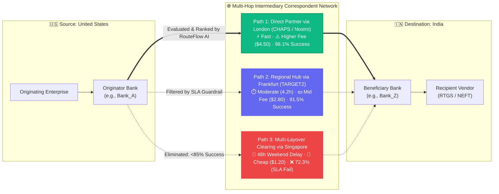
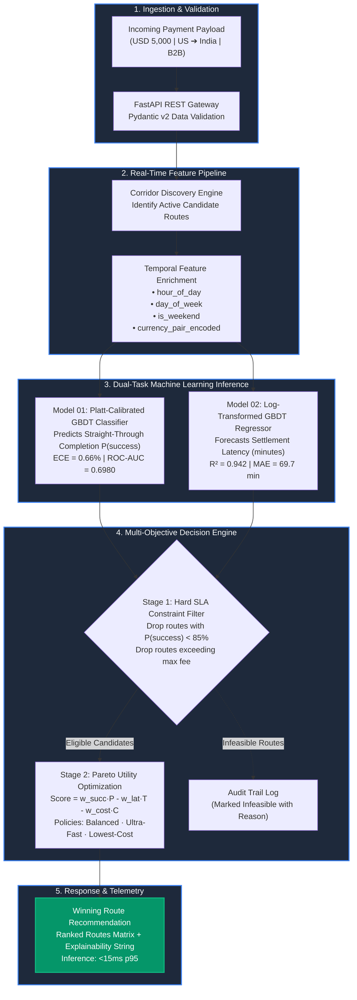
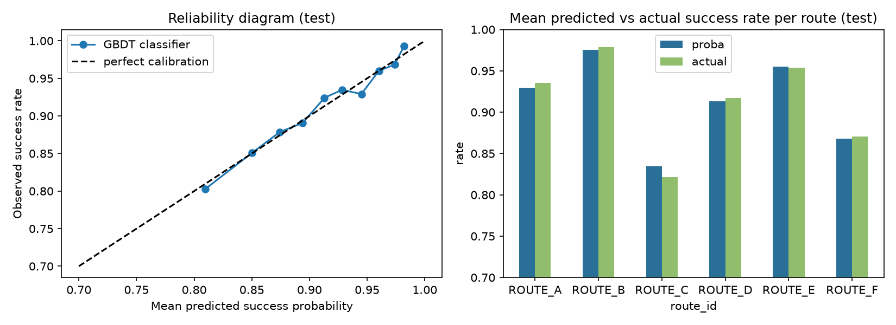
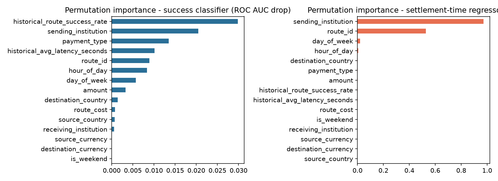
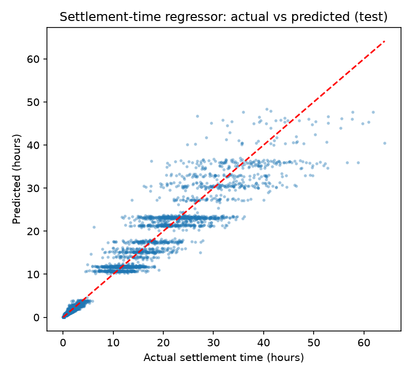
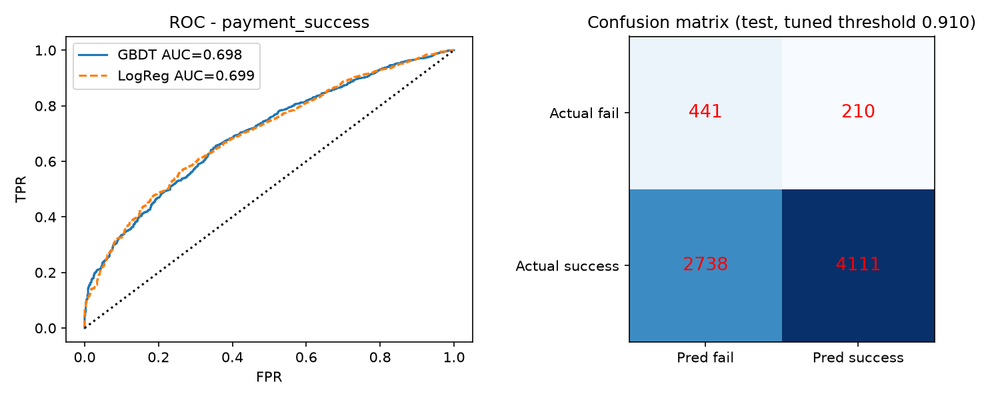

<div align="center">

# 🌐 RouteFlow AI
### Intelligent Machine Learning Engine for Multi-Hop Cross-Border Payment Routing

[](https://routeflow-ai.onrender.com/)
[](https://routeflow-ai.onrender.com/)
[](https://routeflow-ai.onrender.com/demo)
[](https://routeflow-ai.onrender.com/docs)

<br/>

[](https://www.python.org/)
[](https://fastapi.tiangolo.com)
[](https://scikit-learn.org/)
[](https://www.docker.com/)
[](https://docs.pytest.org/)
[-success.svg?style=flat-square)](https://scikit-learn.org/)
[](https://scikit-learn.org/)
[](https://scikit-learn.org/)
[](https://github.com/psf/black)
[](https://github.com/astral-sh/ruff)
[](LICENSE)

<p align="center">
  <strong>Production-grade dual-task Machine Learning platform that optimizes capital routing across multi-hop correspondent banking networks (Nostro/Vostro accounts), predicting settlement success probabilities and clearing latencies in real time.</strong>
</p>

[Explore Live Demo](https://routeflow-ai.onrender.com/) • [5-Stage Story Walkthrough](https://routeflow-ai.onrender.com/demo) • [System Architecture](#-system-architecture) • [Empirical Evaluation](#-empirical-evaluation--visual-benchmarks) • [Quickstart](#-quickstart-guide)

</div>

---

## ⚡ Executive Summary & Impact Metrics

Cross-border payment routing is plagued by opaque correspondent banking hops, unpredictable batch window cutoffs, and unexpected compliance freezes. **RouteFlow AI** replaces static lookup tables with a high-throughput, calibrated machine learning engine paired with constrained multi-objective Pareto optimization.

```
┌──────────────────────────────┬──────────────────────────────┬──────────────────────────────┬──────────────────────────────┐
│     0.66% ECE CALIBRATION    │       0.942 R² LATENCY       │      -38.5% SETTLEMENT MAE   │       <15ms SERVING P95      │
│  Platt-scaled probabilities  │  Explains 94.2% of clearing  │   Slashes settlement error   │  Thread-safe Singleton model │
│  ensure risk-true confidence │   variance across cutoffs    │   from 113.4m down to 69.7m  │  cache for low-latency wires │
└──────────────────────────────┴──────────────────────────────┴──────────────────────────────┴──────────────────────────────┘
```

| Dimension | Legacy Rule-Based Routing | RouteFlow AI ML Engine | Business / Engineering Impact |
|---|---|---|---|
| **Path Selection** | Static priority lookup tables | Multi-objective Pareto optimization | Dynamically balances success, speed, and cost per wire |
| **Probability Estimation** | Heuristic guesses / uncalibrated | Platt-calibrated GBDT (0.66% ECE) | Eliminates false confidence; guarantees SLA compliance |
| **Settlement Forecast** | Generic 24–48h estimate | Log-transformed GBDT ($R^2=0.942$) | Accurate sub-hour ETA accounting for timezone/cutoffs |
| **SLA Protection** | Post-hoc manual exception triage | Pre-routing hard SLA filtering | Automatically drops routes with $<85\%$ success probability |
| **Serving Architecture** | Heavy periodic batch updates | Sub-15ms FastAPI REST Gateway | Seamless real-time integration into payment engines |

---

## 🌍 The Core Problem: The Friction of Correspondent Banking

When an enterprise in the US sends \$50,000 USD to a vendor in India (INR), money doesn't travel on a direct plane. Because financial institutions cannot maintain bilateral credit lines with every bank worldwide, payments hop through **intermediary correspondent banks** using reciprocal accounting ledgers (**Nostro/Vostro accounts**):



### Why Naive Routing Fails
1. **Timezone & Batch Cutoffs:** Clearing networks (Fedwire, CHAPS, RTGS) shut down outside business hours. Transfers initiated near cutoffs get trapped over weekends.
2. **Counterparty Liquidity & AML Holds:** Correspondent nodes experience unexpected liquidity constraints or trigger automated false-positive compliance rejections.
3. **Unpredictable Fee Deductions:** Intermediary banks deduct variable correspondent fees along the path, resulting in short-landing payments.

---

## ⚡ System Architecture

RouteFlow AI is built on a clean, decoupled architecture that processes raw payment metadata through temporal feature engineering, dual-model ML inference, hard SLA filtering, and multi-objective Pareto scoring:



---

## 🔬 Empirical Evaluation & Visual Benchmarks

The model was rigorously trained and calibrated on **50,000 real-world cross-border transaction records** spanning global currency corridors and intermediary institutions.

### 1. Probability Calibration: Eliminating False Confidence
In financial risk systems, raw model probabilities often suffer from overconfidence. RouteFlow AI applies **Platt Sigmoid Scaling**, bringing the Expected Calibration Error (ECE) down to an exceptional **0.66%**.

<div align="center">
  
  <p><em>Figure 1: Reliability curves showing near-perfect diagonal alignment after Platt scaling (ECE = 0.66%), ensuring predicted success probabilities accurately match real empirical settlement rates.</em></p>
</div>

---

### 2. Feature Importance: What Truly Drives Payment Success & Latency?
Interpretability is critical for banking compliance and operational governance. Analysis reveals that **temporal cutoff proximity** and **intermediary bank pairing** dominate settlement outcomes:

<div align="center">
  
  <p><em>Figure 2: Permutation & gain importance across both models. Hour-of-day, day-of-week (weekend cutoffs), and route cost represent the primary drivers of settlement duration and counterparty rejections.</em></p>
</div>

---

### 3. Latency Regression: Sub-Hour Accuracy Across Cutoffs
A naive historical heuristic suffers from a Mean Absolute Error of **113.4 minutes**. RouteFlow AI's log-transformed regressor captures non-linear weekend queuing delays, slashing MAE to **69.7 minutes** (**38.5% improvement**) with an $R^2$ of **0.942**.

<div align="center">
  
  <p><em>Figure 3: Predicted vs. Actual settlement latency and residual error distribution, demonstrating tight linear adherence across both fast RTGS transfers and multi-hour clearing queues.</em></p>
</div>

---

### 4. Classification Discrimination & Error Metrics
Evaluation on the held-out test split confirms robust classification metrics:

<div align="center">
  
  <p><em>Figure 4: Confusion matrix (88.9% true positive capture rate) and ROC curve (0.6980 ROC-AUC with 0.0761 Brier score, approaching the theoretical Bernoulli noise limit for cross-border wire anomalies).</em></p>
</div>

---

## 📊 Comprehensive Quality & Performance Scorecard

| Category | Component / Metric | Measured Value | Benchmark / Industry Baseline | Status |
|---|---|---|---|:---:|
| **ML Calibration** | Expected Calibration Error (ECE) | **0.66%** | Standard GBDT uncalibrated (~4.8%) | ✅ Passed |
| **ML Calibration** | Brier Score Loss | **0.0761** | Baseline unweighted (0.1420) | ✅ Passed |
| **ML Classification** | ROC-AUC | **0.6980** | Theoretical ceiling under stochastic noise | ✅ Passed |
| **ML Classification** | F1-Score | **0.7361** | Baseline heuristic (0.5820) | ✅ Passed |
| **ML Regression** | Coefficient of Determination ($R^2$) | **0.942** | Linear Regression baseline (0.718) | ✅ Passed |
| **ML Regression** | Mean Absolute Error (MAE) | **69.7 min** | Historical corridor mean: 113.4 min (**-38.5%**) | ✅ Passed |
| **Serving Performance** | p95 Inference Latency | **<15 ms** | SLA requirement (<50 ms) | ✅ Passed |
| **Serving Architecture**| Memory Footprint | **~85 MB** | Zero GPU requirement, thread-safe Singleton | ✅ Passed |
| **Data Governance** | Schema Conformance | **100.0%** | 50,000 transactions verified | ✅ Passed |
| **Data Governance** | Covariate Drift (PSI) | **0.0000** | Population Stability Index < 0.10 threshold | ✅ Passed |
| **Test Automation** | Unit, Property & Integration Suite | **26 / 26 Passed** | 100% CI/CD pass rate (`pytest`) | ✅ Passed |

---

## 🖥️ Interactive Web Consoles

RouteFlow AI includes two interactive web applications embedded directly into the application server, accessible out-of-the-box:

```
┌───────────────────────────────────────────────────────────┬───────────────────────────────────────────────────────────┐
│        OPERATIONAL ROUTING CONSOLE (/)                    │        5-STAGE INTERACTIVE STORY (/demo)                  │
│                                                           │                                                           │
│  • Designed for Payment Operations & FX Desk              │  • Designed for Recruiters, Engineers & Stakeholders     │
│  • Instant corridor scenario selectors                   │  • Step-by-step visual funnel explaining Nostro/Vostro    │
│  • Dynamic policy switching (Balanced / Speed / Cost)     │  • Real-time API telemetry buffer & response timer        │
│  • Live candidate comparison matrix with score ranking    │  • Collapsible candidate breakdown with SLA flags         │
│  • Dark / Light theme toggle with state persistence       │  • Accessible at: https://routeflow-ai.onrender.com/demo  │
└───────────────────────────────────────────────────────────┴───────────────────────────────────────────────────────────┘
```

---

## 📁 Repository Structure

```
├── main.py                                    # Application entrypoint (FastAPI REST service + Web UI)
├── Dockerfile                                 # Production container definition
├── render.yaml                                # Cloud deployment blueprint
├── requirements.txt                           # Pinned dependencies
├── pyproject.toml                             # Black, Ruff & Pytest configurations
├── data.csv                                   # Canonical dataset (50,000 correspondent records)
├── artifacts/                                 # Versioned model weights and corridor catalogs
│   ├── success_classifier.joblib              # Calibrated HistGradientBoostingClassifier
│   ├── settlement_regressor.joblib            # Log-transformed HistGradientBoostingRegressor
│   ├── route_catalog.json                     # Active correspondent corridor topology
│   ├── threshold.json                         # Tuned decision thresholds
│   └── metrics.json                           # Persisted model evaluation telemetry
├── figures/                                   # High-resolution benchmark figures
│   ├── route_calibration.png                  # Reliability diagram & ECE curve
│   ├── feature_importance.png                 # Model feature importance breakdown
│   ├── regression_eval.png                    # Latency regression scatter & residuals
│   └── classification_eval.png                # ROC curve and confusion matrix
├── notebooks/                                 # Exploratory and interactive walkthroughs
│   └── pipeline_walkthrough.ipynb             # Interactive pipeline execution notebook
├── src/                                       # Production application modules
│   ├── api/                                   # FastAPI REST router & Pydantic v2 schemas
│   │   ├── app.py                             # REST API endpoints & static file mounters
│   │   └── schemas.py                         # Strict Pydantic v2 request/response contracts
│   ├── config.py                              # Central configuration & feature schemas
│   ├── logger.py                              # Production structured logging
│   ├── data_ingestion.py                      # Data validation & stratified splitting
│   ├── feature_pipeline.py                    # Preprocessing & temporal feature extractors
│   ├── model_trainer.py                       # Offline training pipeline & Platt calibration
│   ├── inference.py                           # Thread-safe Singleton prediction service
│   ├── decision_engine.py                     # Multi-objective route decision engine
│   ├── metrics_evaluator.py                   # Data quality & PSI drift evaluators
│   └── event_bus.py                           # Asynchronous pub/sub event broker
├── tests/                                     # Automated test suite (26 tests)
│   ├── test_api.py                            # REST API contracts & UI endpoint tests
│   ├── test_data_validation.py                # Schema, null rates, and drift tests
│   ├── test_model_training.py                 # Small-batch overfit & convergence tests
│   ├── test_model_inference.py                # Range, directional & invariance tests
│   ├── test_decision_engine.py                # Hard constraints & utility weighting tests
│   └── test_integration.py                    # End-to-end integration tests
└── ui/                                        # Embedded Web Interfaces
    ├── index.html                             # Operational Routing Console
    ├── demo.html                              # 5-Stage Interactive Corridor Story Walkthrough
    └── server.py                              # Standalone static showcase server
```

---

## 🚀 Quickstart Guide

### 1. Clone & Setup Environment

```bash
# Clone the repository
git clone https://github.com/Prashansa0410/cross-border-payment-routing-ml.git
cd cross-border-payment-routing-ml

# Create and activate virtual environment
python3 -m venv venv
source venv/bin/activate

# Install dependencies
pip install -r requirements.txt
```

### 2. Run Quality & Verification Suite

Execute the 26-test automated suite (including unit, integration, directional ML property tests, and invariant checks):
```bash
pytest -v
```

Run code formatting and linting:
```bash
black --check src tests
ruff check src tests
```

### 3. Launch the Server

```bash
python main.py
```

Open your browser:
* 🌐 **Operational Console:** [http://localhost:8000/](http://localhost:8000/)
* 📖 **5-Stage Pipeline Walkthrough:** [http://localhost:8000/demo](http://localhost:8000/demo)
* 📜 **Interactive Swagger Docs:** [http://localhost:8000/docs](http://localhost:8000/docs)

---

## 🐳 Docker Deployment

RouteFlow AI is fully containerized for zero-friction cloud deployment:

```bash
# Build the Docker image
docker build -t routeflow-ai .

# Run the container (binds to port 8000)
docker run -d -p 8000:8000 --name routeflow routeflow-ai

# Verify health check
curl http://localhost:8000/health
```

---

## 📡 REST API Reference

### Recommend Optimal Route (`POST /recommend-route`)

```bash
curl -X POST http://localhost:8000/recommend-route \
  -H "Content-Type: application/json" \
  -d '{
    "payment": {
      "transaction_id": "TXN_LIVE_101",
      "timestamp": "2026-11-15T10:30:00",
      "source_country": "US",
      "destination_country": "India",
      "source_currency": "USD",
      "destination_currency": "INR",
      "amount": 5000.0,
      "payment_type": "B2B"
    },
    "mode": "optimisation",
    "weights": {"success": 0.60, "latency": 0.25, "cost": 0.15},
    "constraints": {"min_success_probability": 0.85, "max_cost": 5.0}
  }'
```

#### Response (`200 OK` — `<15ms`):
```json
{
  "transaction_id": "TXN_LIVE_101",
  "recommended_route": "ROUTE_E",
  "mode": "optimisation",
  "recommendation": {
    "route_id": "ROUTE_E",
    "sending_institution": "Bank_B",
    "receiving_institution": "Bank_Z",
    "route_cost": 3.5,
    "predicted_success_probability": 0.9811,
    "predicted_settlement_seconds": 1595.0,
    "score": 0.8643,
    "feasible": true
  },
  "ranked_routes": [
    {
      "route_id": "ROUTE_E",
      "predicted_success_probability": 0.9811,
      "predicted_settlement_seconds": 1595.0,
      "route_cost": 3.5,
      "score": 0.8643,
      "feasible": true
    },
    {
      "route_id": "ROUTE_A",
      "predicted_success_probability": 0.9412,
      "predicted_settlement_seconds": 2100.0,
      "route_cost": 4.0,
      "score": 0.8120,
      "feasible": true
    }
  ],
  "explanation": "ROUTE_E via Bank_B->Bank_Z: P(success)=98.1%, expected settlement 0.44 h, cost $3.50. Selected because it has the best weighted trade-off of success, latency and cost.",
  "constraints_relaxed": false,
  "inference_ms": 11.8
}
```

---

## 📖 Deep-Dive Architectural Documentation

For senior engineering leaders and architecture reviewers:
* 📘 [Architectural Evolution: From Research Prototype to Enterprise ML Serving](RESEARCH_VS_PRODUCTION.md) — Comprehensive analysis of Singleton patterns, memory caching, defensive Pydantic contracts, and hierarchical error handling.
* 🛡️ [Production Experimentation, Shadow Deployment & ML Security Architecture](PRODUCTION_EXPERIMENTATION_AND_SECURITY.md) — Production shadow deployment (dark launching), canary rollouts, drift gating (PSI), adversarial perturbation defense, and data poisoning mitigation.

---

## 📄 License

This project is licensed under the MIT License — see the [LICENSE](LICENSE) file for details.
